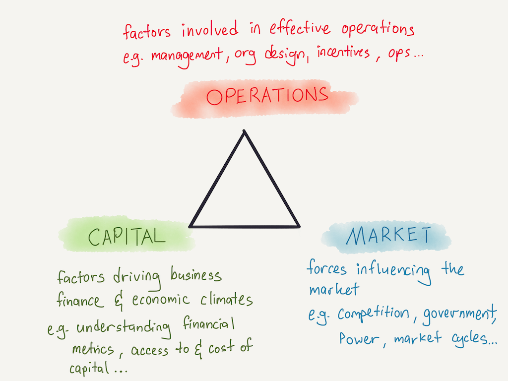
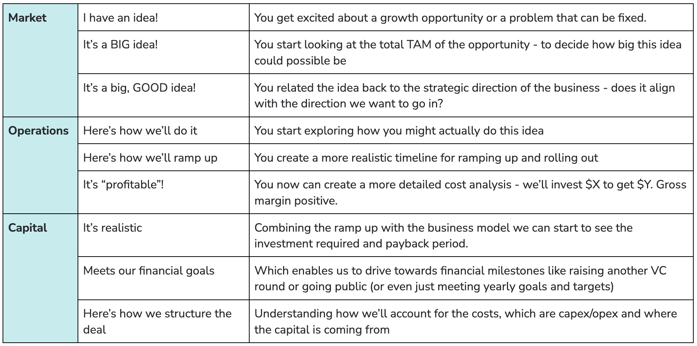
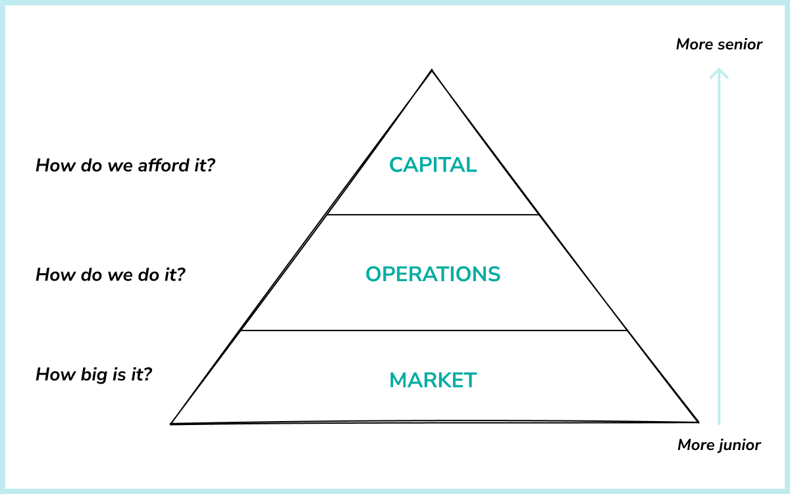
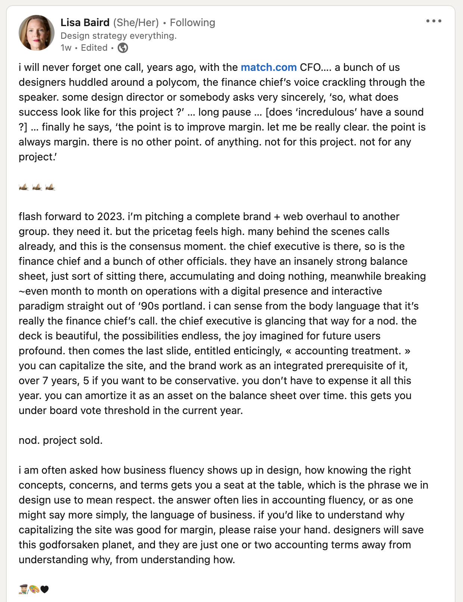
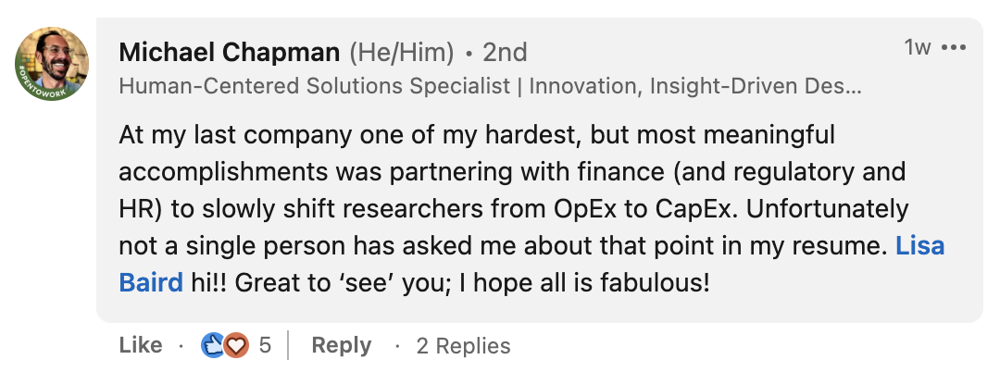
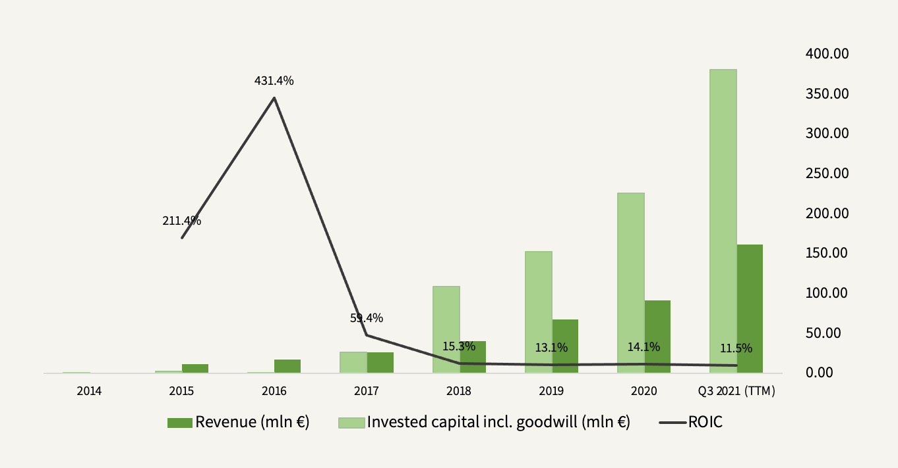

{% include summary.html content="
* Early in your career you go looking for problems & opportunities, but this isn’t enough to persuade the business to invest in them
* We can make our ideas more rigorous and realistic by analyzing them through the lens of the business expertise triad of: market, operations & capital
* In particular, once you reach the capital decision for certain projects it’s not a binary “can we afford this” but rather a strategic “how do we account for this”
* While you don’t get to apply these ideas every day, being fluent in these concepts is a key part of executive presence and helps you earn a seat at the table
" %}

When you’re more junior in your career you focus on “good ideas”. You go looking for problems with the business and think of ways to solve them, or go looking for opportunities and think of ways to capture them. This sounds so obvious as to be banal - but it turns out working inside a business, pointing at problems or opportunities and suggesting solutions…. just doesn’t really work.

Instead, we need to think through not just whether it’s a “good idea” but how much of a good idea it is, what the opportunity cost is, whether we can do it and how we might account for the costs.

## Enter the Business Expertise Triad

The [business model expertise triad](https://commoncog.com/business-expertise/) that Cedric Chin has been writing about at Commoncog (which I highly recommended subscribing to) is a useful framework for thinking through developing an idea into a real pitch:

These three factors are a good set of guardrails for going beyond saying “this is a good idea”:

* **Market**: is there a compelling market for this idea? How does it differentiate against competitors? Do people want it? How big a market is there?
* **Operations**: can we build something that meets this problem/opportunity? If we can, how scalable is it?
* **Capital**: can we afford it? Is it going to be margin profitable as well as revenue generating? Over what time horizon?

Going deeper, you can break each of these three areas down into a set of laddering ideas:

For me personally, and I think many others, you typically start with the market and work your way upwards from there:

This also models my career - when you’re more junior you try and pitch ideas that ONLY think about the market (“it’s a big idea! We should do it!”) without properly considering the operations and capital aspects.

As I’ve become more experienced I’ve become much better at thinking about questions like:

* **Have I properly accounted for ALL the costs related to the project**? (I saw a pitch recently where the pitch deck said “we recommend a PR push on launch” and then didn’t have any PR costs included in the spreadsheet business model…)
* **What is the unit economics of the project**? The overall “spend $X to get $Y” is vaguely useful but once you can start to create a unit economics calculation you can start to have real conversations, instead of “we should do the project” you can discuss “how much of this should we do, and how fast?”
* **How much is this project aligned to the strategic goals of the organization**? If a project is aligned to the overall company strategy it’s FAR more likely to receive investment. I wrote more about this idea of [making projects strategically aligned here](https://newsletter.seomba.com/p/are-you-making-seo-strategically).

These are all things I’ve improved on over time but the latest area of growth for me personally has been in the capital bucket:

## Going beyond Revenue & Costs

For most of my career I’ve operated with a relatively basic view of accounting, thinking primarily about **revenue** and **costs** - asking questions like *“how much does this cost and how much $ will we make from it”*.

This is good enough for a lot of basic decisions but as you work with larger projects and get more senior inside business you’ll encounter ways in which this isn’t the logic behind how decisions are made.

**Beyond revenue** - you start thinking about margin, cash flow and eventually up to equity - asking *“how much does this cost and how much equity value does it build in the business?”* where equity is dependent on valuation, type of business etc.

**Beyond costs** - you start thinking about different ways to account for costs, whether you’re allocating them as capex or opex, and how to get access to cheap sources of capital.

The ways these ideas show up are varied - from loading up on debt, to structuring multi-year deals with depreciation, there are more creative ways to fund things than you might realize - the core insight being that companies primarily think about their P&L rather than their bank account.

## Enter: Strategic Finance

Having been involved in several discussions recently it’s increasingly obvious the difference between treating finance as a go/no-go function that “holds the purse strings” vs treating finance as a strategic function that can enable creative funding strategies to fund, offset or de-risk various investments.

From [Financial Flexibility and Opportunity Capture: Bridging the Gap Between Finance and Strategy](https://onlinelibrary.wiley.com/doi/10.1111/jacf.12274) (bolding mine):

> **Classic Competitive Strategy theory assumes that advantage comes from operational superiority**—that is, practices, processes, technologies and positioning that result in lower unit costs and/or superior product qualities. Attractive investment opportunities arise from these operating advantages. Cost or product quality advantages are the means to achieve competitive advantage. That implies, though, that the strategic horizon around such prescription is open ended; the opportunities are generic
>
> **Such conventional strategy theory does not sufficiently acknowledge the constraints impacting opportunity capture.** In reality, firms’ business opportunities and associated growth are typically restricted to a relatively small set of possibilities. Some are controlled already by competitors and others by players that cannot be easily influenced (such as foreign governments).
>
> **Crucially, the available possibilities are often transient and also available to competitors. In these situations, operating factors may be far from decisive**. Controlling parties, such as governments, are often more concerned with financing issues, capital project execution, and government revenue. Superior financing capacity then becomes an advantage in convincing controlling parties to award opportunities.
>
> Standard strategy theory also says nothing about how capital market conditions change the strategic landscape. **Implicitly, strategy theory adopts the ‘self-financing’ assumption of financial theory and ignores how superior financial flexibility allows some competitors to seize the best available prospects while others are immobilized**.

Simply put, the existing view of “business strategy” undervalues and neglects the idea of financial flexibility as a differentiator.

## Examples of Strategic Finance

This is all pretty theoretical (especially for those earlier in their career who perhaps haven’t been exposed to this level of discussion) so let’s give some examples, mostly from recent memory in my consulting work:

### Capex vs Opex: 

The capex/opex distinction matters primarily because of when you realize the cost - with the ability to realize a capital expense over a multi-year period (although typically the cash is spent immediately).

Here’s a nice illustration of this idea from [Lisa Baird](https://www.linkedin.com/feed/update/urn:li:activity:7122210042333802497/):

Which a nice addendum from [Michael Chapman in the comments](https://www.linkedin.com/feed/update/urn:li:activity:7121837004073361408?commentUrn=urn%3Ali%3Acomment%3A%28activity%3A7121837004073361408%2C7121881733288886272%29&dashCommentUrn=urn%3Ali%3Afsd_comment%3A%287121881733288886272%2Curn%3Ali%3Aactivity%3A7121837004073361408%29):

There’s a healthy debate right now in the branding and marketing industries of how to [properly account for brand investment](https://ipa.co.uk/news/investment-analyst-survey):

> “When asked whether they thought marketing spend should be treated like Technology R&D, where it is capitalised, nearly 90% of analysts said they believe marketing spend should be placed in capital expenditure either all (56%) or part of the time (33%).
>
> Two-thirds of analysts (67%) also want to see changes to how intangible assets as a whole are reported upon and accounted for.
> 
> Those that stated they think it should be capitalised at least some of the time believe it would improve their ability to value the company and give them better understanding of future growth potential.”

I don’t believe there’s a right or wrong answer here but these conversations are happening in all kinds of management teams right now.

### Using an IPO to unlock capital

The core of financial flexibility that we saw above is the ability to have access to capital when you need it - to be able to capture opportunities that competitors can’t. A great example of this is Better Collective (disclaimer, a client back in 2018) - they went public in 2018 and have since used their IPO capital to fuel an acquisition spree:

> “But note that the growth couldn’t have happened to the extent it has without firing up the M&A machine, which Better Collective did in 2017 right before the IPO that gave the company the right foundation to take on more ambitious targets.” [source](https://junto.investments/better-collective/)

*(Aside: if you're not familiar with the idea of ROIC (return on invested capital) with/without goodwill then [read this](https://www.fool.com/how-to-invest/return-on-invested-capital-true-performance.aspx#:~:text=In%20short%2C%20the%20formula%20for%20ROIC%20is%3A).)*

This M&A spree includes the acquisition of Action Network for $240m in 2021 to fuel Better Collective’s aggressive push into the US market as online gambling regulation changed:

> On May 14, 2018, the United States Supreme Court ruled PASPA unconstitutional and paved the way for states to self-regulate retail and online sports betting.
> 
> Now, as more states legalize sports betting across the US and competition between operators continues to heat up, we’ve seen a flood of M&A and licensing-based media content partnerships over the last 12-18 months. [source](https://huddleup.substack.com/p/-action-network-sells-for-240-million)

This feels like a great example of financial flexibility - there aren’t many strategic moves available, but some are only available if you have $240m lying around…

Of course - Better Collective most likely didn’t spend $240m in cash. M&A is more complicated than that. 

### Paying for M&A with debt, their debt

Speaking of M&A - in the above example it’s fairly straightforward, the IPO generated cash and they used that to buy companies. Of course Better Collective likely didn’t use 100% cash to acquire most of these companies - they likely used a combination of equity, cash and debt to make the deals.

There are actually a whole host of ways that you can afford and account for M&A deals. The most interesting is a leveraged buy-out. Where a business with strong cash-flow can be acquired by taking out debt - and *putting the debt on the balance sheet of the business being acquired*. This dramatically lowers the amount of cash that the acquirer has to put up front - even up to 90 or 100% of the purchase price.

While this has historically been seen as somewhat predatory (since the loan repayments you end up with are significant) if other financing options aren’t available and there’s strong cash-flow in the business being acquired then it can make sense, especially in low interest environments (which, as you know we are NOT in right now - so [the debt portion of LBO deals is at all time lows right now](https://www.axios.com/2023/10/24/high-interest-rates-private-equity-lbos)).

## OK, so what?

It’s not easy to immediately apply these ideas. You can’t decide to go public tomorrow just to finance an M&A deal you want to make. And you can’t change the accounting structure of your spending without some headaches. These are big, slow moving ideas.

But I find it incredibly useful to understand that these moves exist - part of executive presence is not being left behind in conversations - and many high level discussions touch on finance as a strategic lever. Not just at the revenue/margin/cashflow level but at the debt/financing/accounting level and it’s worthwhile being fluent in these ideas to ensure you have a seat at the table.